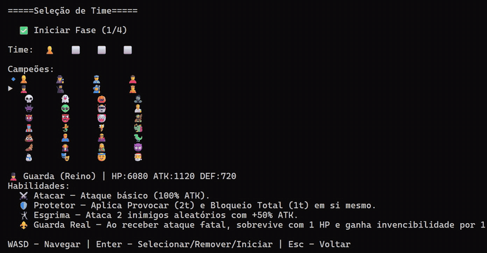
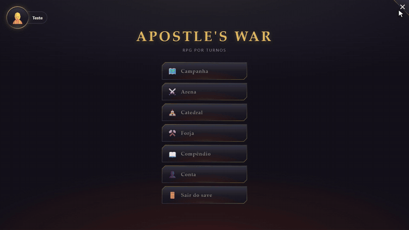
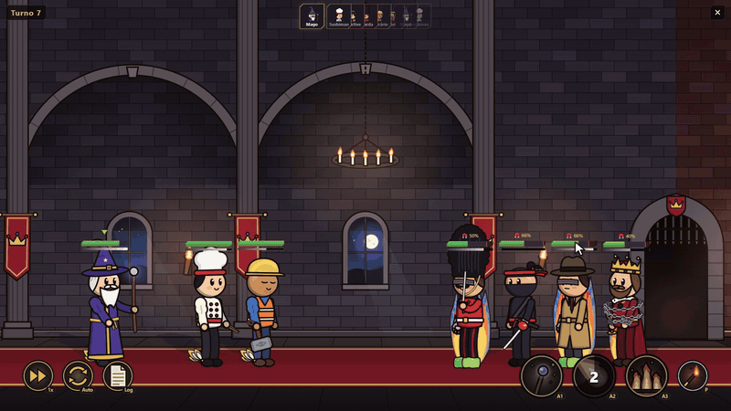

# Olá, eu sou o Gabriel 👋

Desenvolvedor **.NET · C#**, em Blumenau. Começo pelo problema de quem usa, decido com o que observo e coloco no ar.

Formado no **Entra21** (C# / .NET, 320 horas) e cursando Engenharia de Software (Uniasselvi, 4º semestre). Antes do código, mais de cinco anos em telecom, onde aprendi a ler o sintoma, isolar a causa e testar a hipótese antes de mexer.

📍 Blumenau, SC · 🟢 Aberto a vagas júnior CLT (local/híbrido) · 🌐 [gabrielhenriquece.github.io](https://gabrielhenriquece.github.io/)

---

## 🌐 [Cé Sites](https://cesites.com.br) — meu negócio de sites para pequenas empresas

- **Para quem:** dono de pequeno negócio, que quer um site sem dor de cabeça.
- **O que decidi:** tudo pelo WhatsApp, sem formulário. A página pronta antes de pagar. O domínio no nome do cliente, não no meu.
- **O que observei:** no teste com pessoas, no celular, todo mundo passava a animação inteira rolando e não lia nada.
- **O que mudei:** tirei a rolagem presa e troquei por um carrossel que a pessoa passa e lê.

`HTML · CSS · JavaScript · three.js`

---

## 🥉 [Fala Sério](https://falaserio-eight.vercel.app) — orientação em saúde menstrual

3º lugar no Startup Weekend Blumenau: 54 horas, com um time formado no evento.

- **O que ouvimos:** nove entrevistas apontaram o mesmo bloqueio: a dor existe, mas a informação não chega.
- **O que decidimos:** uma enfermeira para dizer se o que ela sente é esperado ou se é hora de procurar um ginecologista, na conversa onde ela já está e sem aplicativo.
- **O que a regra mudou:** pela ANS, a assinatura não pode garantir consulta, então o plano inclui prioridade de agendamento. Pelo COFEN, a telenfermagem exige registro auditável, e WhatsApp puro não cumpre.
- **Minha parte:** o site do projeto.

---

## 🏗️ [NoPrumo](https://github.com/GabrielHenriqueCe/NoPrumo) — gestão de obras para construtoras

TCC do Entra21, em equipe de cinco pessoas.

- **O que decidimos:** a obra é o centro do sistema. O mestre enxerga quantidade e a administração enxerga dinheiro.
- **Por quê:** esconder na tela não basta: se o valor vier no JSON, o DevTools mostra. Por isso a API devolve um DTO por perfil.
- **Liderança:** liderei a equipe: dividi o trabalho em fatias e coordenei a entrega e a revisão de cada uma.
- **O que fiz:** o login com JWT, a tela de login e o cadastro de usuários, as obras e etapas, o financeiro da obra e o painel.

`.NET 8 · ASP.NET Core Web API · EF Core · MySQL · JWT · React · xUnit`

---

## ⚔️ Apostle's War — RPG por turnos, em desenvolvimento

Meu projeto de estudo, inspirado em Raid: Shadow Legends. Começou em março, no console, e hoje é jogável de ponta a ponta numa janela. O repositório é privado, e posso mostrá-lo em entrevistas.

- **O que aprendi no Entra21:** a montar uma arquitetura e regras decentes, com código mais limpo em C#. As regras do jogo não sabem desenhar nada: falam com a tela por uma interface, e foi isso que permitiu trocar o console pela janela sem reescrever o combate.
- **A mudança de rumo:** o jogo vinha sendo desenhado como um gacha, até eu perceber que esse não era o destino que eu queria para ele. Fiz uma pausa e agora vou fazer um MVP offline, com as mesmas mecânicas de batalha e a mesma vontade de voltar e ficar mais forte.
- **Com IA:** desenvolvi com o Claude Code, e os commits co-autorados estão no histórico. A direção é minha: decidi a arquitetura e as regras, opinei muito em cada parte e ajustei muita coisa na mão. No caminho aprendi sobre harness, skills e a economizar token.
- **Agora:** estou me desprendendo da IA e usando ela mais como ferramenta. Estou refazendo o visual à mão, no Figma, peça por peça, para o jogo ter a minha identidade.

**1. Console**

**2. Telas**

**3. Palco 2D**

`C# · .NET 10 · Clean Architecture · WebView2 · JavaScript · xUnit`

---

## 🤖 Como trabalho com IA

Uso IA (Claude Code) todo dia para estudar e programar, e busco melhorar sempre: fiz o Entra21, curso Engenharia de Software e treino por conta própria. Sou explícito sobre isso: os commits co-autorados estão no histórico.

- **[claude-padrao](https://github.com/GabrielHenriqueCe/claude-padrao):** as regras que ela segue nos meus projetos, escritas e públicas. Desenho antes do código, nada de commit sem o meu ok, nome que diz o que é.
- **[TrilhaCSharp](https://github.com/GabrielHenriqueCe/TrilhaCSharp):** meu treino com IA. Faço exercícios até não precisar mais dela naquele assunto. Depois volto a usar, e ela deixa de ser muleta e vira ferramenta. É um ciclo.

---

## 🛠️ Stack

C# · POO · .NET 8 · ASP.NET Core MVC e Web API · JWT · Entity Framework Core · SQL e MySQL · LINQ · async/await · injeção de dependência · Clean Architecture · xUnit · HTML · CSS · JavaScript · Tailwind · React · Git e GitHub

---

## 📬 Contato

🌐 [Portfólio](https://gabrielhenriquece.github.io/) · 💼 [LinkedIn](https://www.linkedin.com/in/gabriel-henrique-ce) · ✉️ ga.biel.hce@gmail.com

© 2026 Gabriel Henrique Cé. Todos os direitos reservados.
